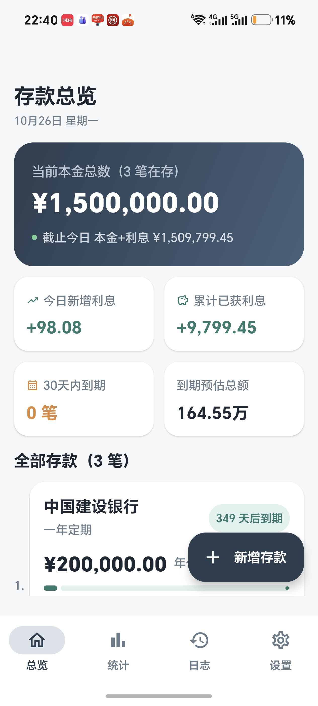
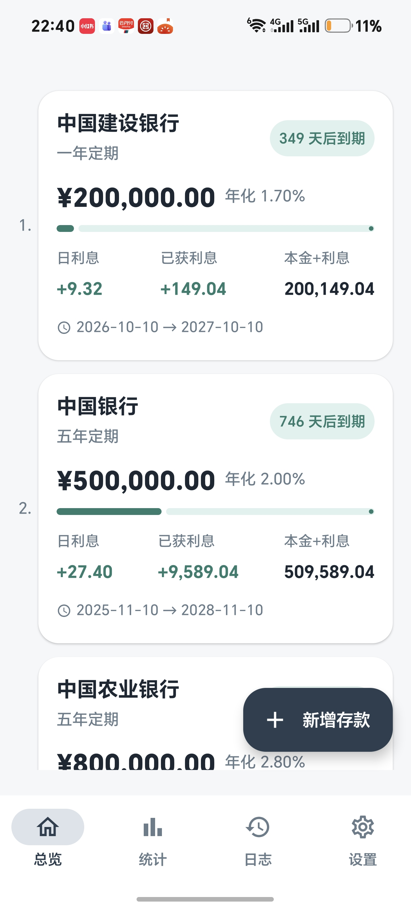
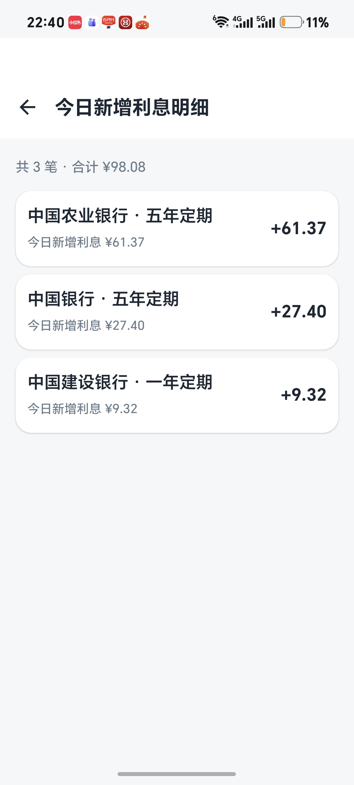
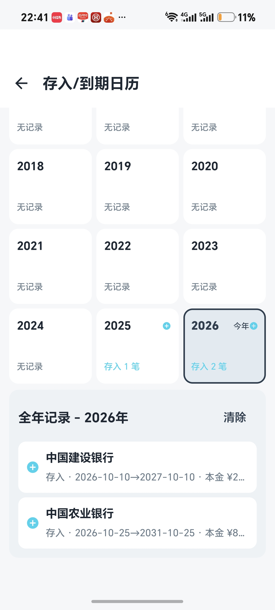
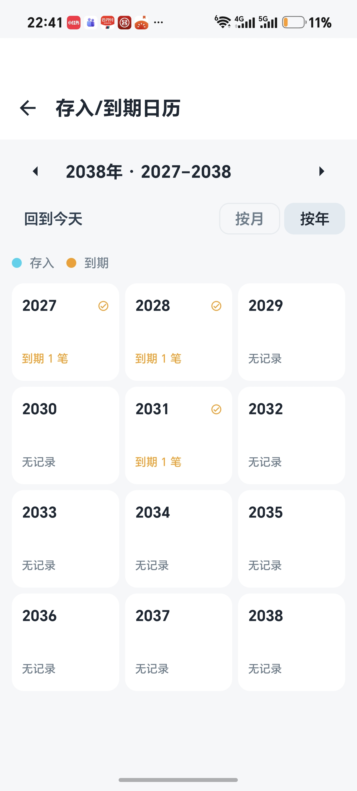
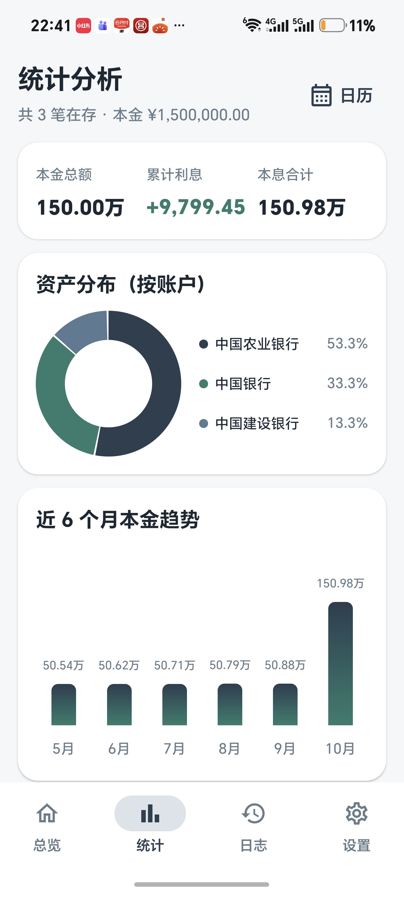
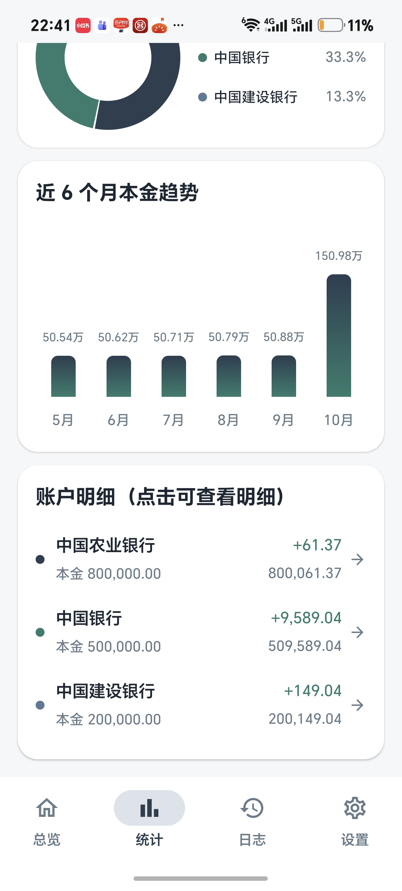
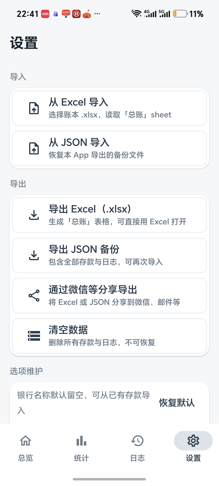
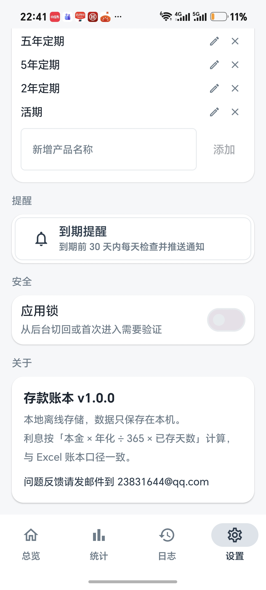

# 存款账本（DepositBook）

你的私人银行存款记账助手，离线、安全、简洁。

## 下载安装

直接从 [Releases](https://github.com/panxy2013/DepositBook/releases) 页面下载最新 APK 安装：

| 版本 | 下载 |
|---|---|
| v1.0.11 | [deposit-book-v1.0.11.apk](https://github.com/panxy2013/DepositBook/releases/download/v1.0.11/deposit-book-v1.0.11.apk) |
| v1.0.10 | [deposit-book-v1.0.10.apk](https://github.com/panxy2013/DepositBook/releases/download/v1.0.10/deposit-book-v1.0.10.apk) |
| v1.0.9 | [deposit-book-v1.0.9.apk](https://github.com/panxy2013/DepositBook/releases/download/v1.0.9/deposit-book-v1.0.9.apk) |
| v1.0.8 | [deposit-book-v1.0.8.apk](https://github.com/panxy2013/DepositBook/releases/download/v1.0.8/deposit-book-v1.0.8.apk) |
| v1.0.7 | [deposit-book-v1.0.7.apk](https://github.com/panxy2013/DepositBook/releases/download/v1.0.7/deposit-book-v1.0.7.apk) |

> 手机上点击下载后，允许安装未知来源应用即可安装。

## 应用简介（中文）

存款一笔一笔散落在不同银行和产品里，利息到底有多少、什么时候到期？存款账本帮你把所有定期存款、理财产品集中管理，随时掌握总资产和未来收益。

**核心功能**

- 📒 **存款记录**：记录银行、产品、本金、年化利率、存入/到期日期，利息自动按「本金 × 年化 ÷ 365 × 已存天数」计算，与 Excel 账本口径一致
- 📊 **统计分析**：总本金、总利息一目了然
- 📅 **存入/到期日历**：月视图、年视图自由切换，轻点日期即可查看当天存入和到期的每一笔存款，支持「回到今天」快速定位
- 🔔 **到期提醒**：每日自动检查即将到期的存款，不错过转存时机
- 📤 **导入导出**：支持 Excel（.xlsx）与 JSON 备份的导入导出，可通过微信、邮件等方式分享，方便换机迁移
- 🧾 **操作日志**：新增、修改、删除、结清全程留痕
- 🔒 **应用锁**：数字密码或手势密码，进 App 或后台切回都要验证，隐私更安心
- 🌏 **中英文切换**：设置页一键切换显示语言，默认中文，选择持久保存
- 📴 **完全离线**：数据只保存在本机，不上传、不联网，没有广告和注册

适合有多个银行存款/理财产品、习惯用 Excel 管账、想随时看清利息收益的用户。

## Overview (English)

**DepositBook — Your private deposit ledger. Offline, secure, and simple.**
Your savings are scattered across banks and products. How much interest have you earned? Which deposit matures next week? DepositBook puts all your fixed-term deposits and wealth products in one place, so you always know your total assets and future earnings at a glance.

**Key Features**

- 📒 **Deposit Records** — Track bank, product, principal, annual rate, and deposit/maturity dates. Interest is calculated as *principal × annual rate ÷ 365 × days held*, consistent with your Excel spreadsheet
- 📊 **Statistics** — Total principal and interest at a glance
- 📅 **Deposit & Maturity Calendar** — Switch between month view and year view; tap any date to see every deposit that starts or matures that day
- 🔔 **Maturity Reminders** — Daily automatic checks so you never miss a rollover
- 📤 **Import & Export** — Excel (.xlsx) and JSON backup support, shareable via WeChat, email, and more — easy device migration
- 🧾 **Operation Log** — A full history of every create, edit, delete, and settle
- 🔒 **App Lock** — PIN or pattern protection, required on first entry and whenever you return from the background
- 📴 **Fully Offline** — Data stays on your device only. No cloud, no account, no ads

Perfect for anyone with deposits across multiple banks who wants a clear, always-available view of their interest income.

---

## 更新历史

### v1.0.11（2026-11-01）
- **新增存款步骤链延伸到 6 步**：1 银行 → 2 存款期限 → 3 本金 → 4 年化利率 → 5 存入日期 → 6 存期
  - 存入日期默认今天：虚线圆圈=待确认，改过日期变绿勾；可跳过
  - 存期默认不显示，选择了「可修改存期」的产品后出现（默认 1 年，可跳过）；固定存期产品只读卡片自动打勾
  - 删除/清空已填内容时，对应步骤自动恢复未完成状态，浮动按钮提示随之回跳
  - 本金按「完成」自动跳到年化利率，利率按「完成」收起键盘
- **文案与布局**：「产品名称」改为「存款期限」（背景提示「选择存款期限」）；本金背景提示「输入本金」；到期日期并入存入日期一行纯文本显示；移除「期限 N 天 · 日利息」提示行
- **界面易读性**：固定存期产品不再显示只读存期栏位（期限名称已说明）；各类灰色提示文字统一放大到 14sp
- **标题统一**：总览页标题间距与其它页对齐；新增/编辑存款、存款详情、日历、银行明细、下钻列表五个二级页顶栏标题字号统一为与主页一致

### v1.0.10（2026-10-31）
- **新增存款全面改造**：
  - 银行/产品/本金三栏左侧显示步骤圆圈序号（1→2→3），完成变对勾、当前步骤高亮
  - 右下角浮动保存按钮，不再被键盘遮挡；旁边实时提示「下一步 第N步 产品名称」
  - 有漏步时点保存会明确列出需要完成的步骤（对应栏位圆圈数字）
  - 顶部留白去除；删除「手动添加银行」区块（输入新银行名称后，下拉顶部出现「添加自定义银行」，选中自动记住）
  - 银行栏提示文字改为「选择存款银行」；下一步提示固定一行显示

### v1.0.9（2026-10-31）
- **隐私与安全锁默认关闭**：新装用户进入总览直接显示金额（设置里仍可随时开启）
- **金额显示改为 4 位分段、只显示整数**：如 12345678.50 显示 `¥1234,5678`；小数部分仅存储不显示（编辑存款时预填完整金额，不会丢失小数）
- **银行图标加大并去留白**：82 家标志图形按实际墨迹范围重新裁切，等边大图标显示，不再左右留白
- **新增存款体验优化**：
  - 产品名称默认留空，输入关键字可筛选全部产品（不再预填导致只筛出一项）
  - 选完银行自动切到产品、选完产品自动切到本金输入
  - 银行/产品输入框自动提示中文输入法（EditorInfo.hintLocales，Android 13+ 生效）
  - 本金弹出数字键盘，按「完成」自动收起键盘
- **新增「活期」预置产品**：默认存期 10 年（3650 天）、存期可修改；老用户已自定义则保留原样（选项自动迁移）

### v1.0.8（2026-10-28）
- 全部 82 家内置银行图标由「标志 + 文字」组合标更换为**纯标志图形**版本，界面更加干净统一
- 另有 3 家（平安、光大、新韩）公开组合标中不含独立的标志图形，不强行裁切，继续使用彩色文字圆标显示
- 图标裁切后溢出视图的部分通过 SVG 剪裁路径约束，确保在低版本渲染引擎上无文字残边

### v1.0.7（2026-10-28）
- 新增内置中国银行清单（100 家：国有 6 大行、股份制、民营、城商行、农商行、外资在华全部离线内置），选银行直接下拉，输入关键字即可筛选（支持「工行」「微众」等简称匹配），不再需要手动录入
- 银行下拉智能排序：有过存单的银行排在前面，其中最近存入的排最前；其余按清单原顺序
- 内置银行显示真实银行 logo（85 家矢量图标本地打包，不联网）；用户自建的银行不带图标，用彩色文字圆标区分
- 总览页存款卡片、详情列表同步显示银行图标；用户自定义银行不带图标
- 产品改为「预置 + 自定义」两层：
  - 系统预置四个整存整取（1/2/3/5 年期，365/730/1095/1825 天），选择后存期自动带出且**固定不可修改**
  - 设置 → 选项维护 里可添加自定义产品：产品名称 + 默认存期（年/月/天 + 数值）+ 「允许修改存期」开关；勾选则选择产品时带出默认存期但仍可改，不勾则存期锁死
- 「选项维护」产品列表显示每项的存期与锁定状态说明，可编辑/删除；「从已有存款导入」会按同名存款的存期自动带出默认存期

### v1.0.6（2026-10-27）
- 支持中英文切换（设置 → 语言）：默认中文，选择持久化保存，切换后全界面立即生效
- 存款编辑页存期单位、Excel 导出表头、到期提醒通知等同步适配双语；导入兼容中英文两种表头
- 金额大数简写随语言变化：中文 万/亿，英文 k/M

### v1.0.5（2026-10-27）
- 手势密码九宫格再放大：占满可用空间 98%、解锁界面顶部留白收窄，点与连线更粗，滑动更容易命回合乎手感

### v1.0.4（2026-10-27）
- 折线图金额标签防重叠：相邻标签自动跳过；同一段水平线上相同金额只在最左边的点标注

### v1.0.3（2026-10-27）
- 本金趋势改折线图，支持「按月 / 按年」切换；按月最长 12 个月、按年最长 12 年
- 从第一个资产大于 0 的点开始显示；跨年时月份标签带年份前缀（如「25年8月」）
- 每个点上方标注金额

### v1.0.2（2026-10-27）
- 新增历史资产快照：每天自动记录总本金 / 累计利息 / 本息合计与在存笔数，删除 / 结清存单不影响已有记录，仅「清空所有数据」会删除（数据库自动迁移，不丢数据）
- 统计页新增「历史资产记录（每日快照）」卡片

### v1.0.1（2026-10-27）
- 应用锁规则完善：导入 / 导出文件时挂起安全锁 2 分钟，返回应用立即恢复锁定；锁屏规则统一退后台标记、返回判定
- 解锁界面支持数字密码 ↔ 手势密码切换；手势密码必须先在设置中配置，强制先配置数字密码
- 手势九宫格放大（约 2.2 倍面积）、锁屏铺满全屏去掉黑边，「请绘制手势密码」标题下移
- 首页总览新增隐私小眼睛：隐藏金额显示 ***，30 天内到期笔数始终可见；设置页可配置默认隐藏
- 导入 / 导出结果以 Toast 明确提示（失败时显示具体原因）

用 Android Studio 直接打开本目录即可编译运行。功能对应你原来的 Excel「总账」表。

## 功能

- **首页总览**：本金总数、今日新增利息、截止今日本金+利息、累计已获利息、30 天内到期笔数
- **存款管理**：新增 / 编辑 / 删除 / 结清，字段与 Excel 一致（账户、产品、本金、年化、存入日、到期日、备注）
- **利息自动计算**：日利息 = 本金 × 年化 ÷ 365；已获利息 = 日利息 × 已存天数
- **到期提醒**：WorkManager 每天检查，到期前 30 天内推送本地通知
- **统计页**：按账户的资产分布环形图、本金趋势折线图（支持按月 / 按年切换）、历史资产记录、账户明细
- **操作日志**：新增 / 修改 / 删除 / 结清均自动记录
- **数据导出**：设置页可导出 JSON 到 Download 目录

## 技术栈

Kotlin · Jetpack Compose · Material 3 · Room · WorkManager · Navigation Compose · Gson

## 编译

1. Android Studio（建议 Hedgehog 以上）打开本目录
2. 等待 Gradle 同步（首次会下载依赖）
3. 连接手机或启动模拟器，点击 Run

> `minSdk 26`（Android 8.0+），`compileSdk 36`。

## 截图预览

| 首页总览 | 存款卡片 | 利息明细 |
|:---:|:---:|:---:|
|  |  |  |

| 到期日历（年视图） | 日历翻页 | 统计分析 |
|:---:|:---:|:---:|
|  |  |  |

| 账户明细 | 导入导出 | 应用锁 |
|:---:|:---:|:---:|
|  |  |  |

更多截图见 `docs/screenshots/` 目录。

## 签名与打包

项目已配置正式签名，`release.jks` + `keystore.properties` 放在项目根目录。

| 命令 | 产物 | 大小 |
|---|---|---|
| `./gradlew assembleDebug` | `app/build/outputs/apk/debug/app-debug.apk` | 约 18 MB |
| `./gradlew assembleRelease` | `app/build/outputs/apk/release/app-release.apk` | 约 2.3 MB |

### 版本号维护

改项目根目录的 `version.properties` 即可，不用动代码：

```properties
versionName=1.0.0
versionCode=auto
```

- `versionName` 显示给用户，例如 `1.0.0`
- `versionCode` 写 `auto` 时自动取当天日期（如 `20261024`），保证每次出包都递增
- 也可以写死具体数字，例如 `versionCode=3`

应用内「设置 → 关于」显示的版本号也从这里读取，会自动同步。

证书信息：

```
DN: CN=DepositBook, OU=Personal, O=PXY, L=Shenyang, ST=Liaoning, C=CN
别名: depositbook
有效期: 10000 天
SHA-256: 90:65:39:B4:39:A4:6A:EF:38:CD:3B:8A:42:7A:17:6A:45:C5:9D:49:9C:39:D6:01:A6:1C:70:40:27:DE:BA:8A
```

**密码保存在 `keystore.properties` 里**，直接用文本编辑器打开就能看到。
`release.jks` 和 `keystore.properties` 已加入 `.gitignore`，不会被提交。

> 重要：`release.jks` 请备份好。以后升级 App 必须用同一个证书签名，否则无法覆盖安装。
> 如果 `keystore.properties` 不存在，Gradle 会自动退回调试证书，保证随时能出包。

## 数据字段

| 字段 | 说明 |
|---|---|
| accountName | 理财账户 / 银行名称 |
| productName | 产品名称（一年定期、活期等） |
| principal | 本金 |
| annualRate | 年化利率（0.04 = 4%） |
| startDate / endDate | 存入日 / 到期日 |
| isActive | 是否仍在计息 |

## 目录

```
app/src/main/java/com/pxy/depositbook/
├── data/          Entity、DAO、Room 数据库、Repository、统计模型
├── ui/            Compose 界面（首页、详情、编辑、统计、日志、设置）
├── util/          日期、利息计算、格式化
├── viewmodel/     HomeViewModel / StatsViewModel / LogViewModel
└── worker/        到期提醒 Worker
```
